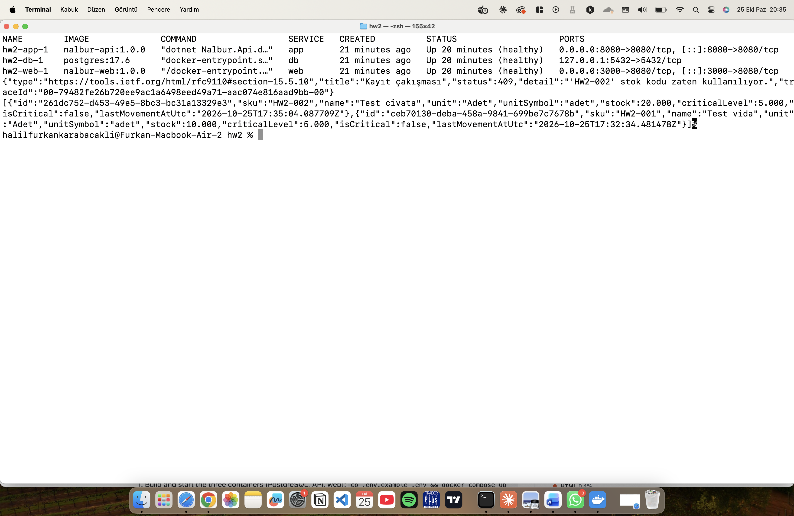
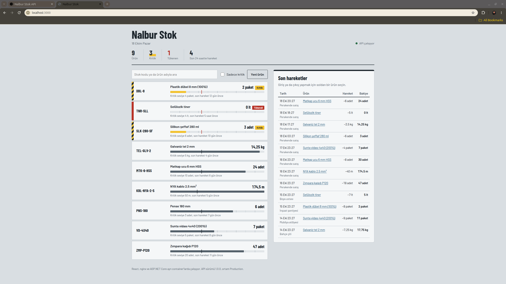
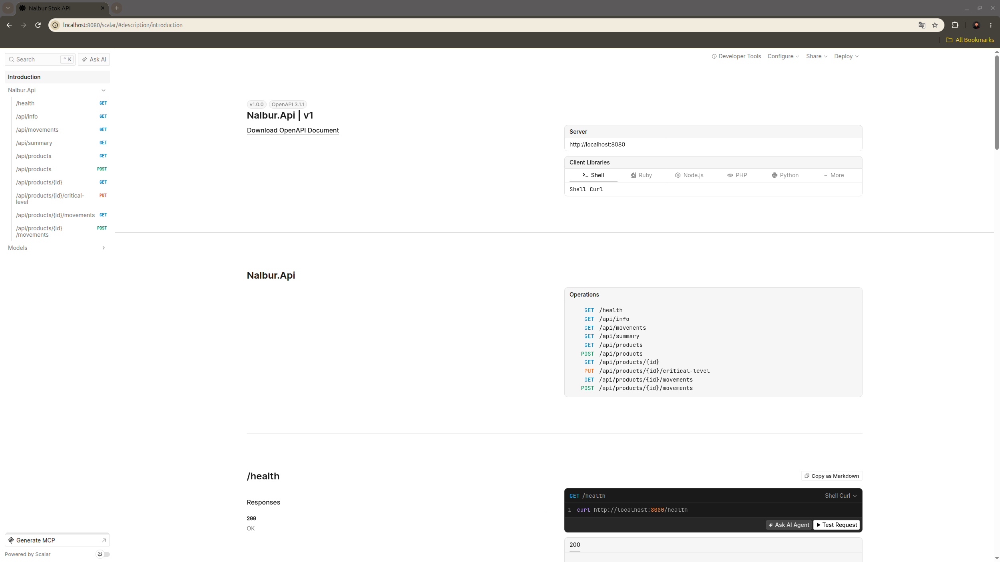
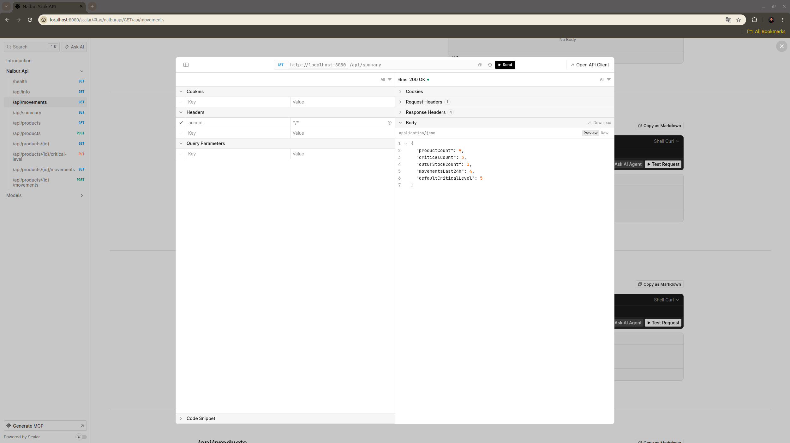
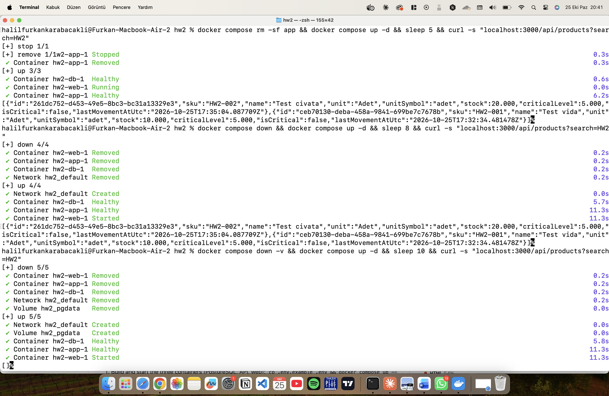

# Screenshots

**`docker compose ps` and a request that proves the state works:** all three services (`db`, `app`, `web`) are running and healthy; the POST tries to add `HW2-002` and gets 409 because that product was already saved, and the GET lists the products stored in PostgreSQL:

**The web app** at http://localhost:3000 (React served by nginx, data from the app and PostgreSQL):

**API docs (Scalar)** at http://localhost:8080/scalar:

**A request from the API docs:** `GET /api/summary` returns 200 OK:

**Stateless test:** the products `HW2-001` and `HW2-002` are still there after `docker compose rm -sf app` and after `docker compose down`; after `docker compose down -v` the volume `hw2_pgdata` is removed and the result is `[]`:

